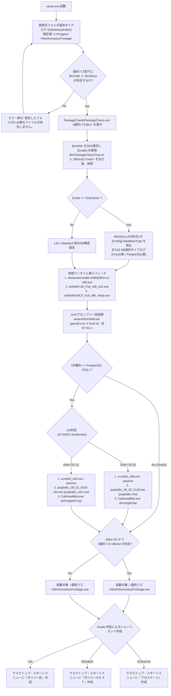

# ガリバー・プロステージ ver 6.2.0（クラサバ版）静的解析レポート

## 1. エグゼクティブサマリー（全体像とアーキテクチャの正体）

対象ディレクトリ（`[W10-64bit] ガリバー・プロステージ ver 6.2.0(クラサバ版)Full新規インスト用`）に含まれるバイナリ群・InstallShieldコンパイル済みスクリプト（`setup.inx`）・CABヘッダ（`data1.hdr`）・付属.NETアセンブリ一式を静的解析した結果、以下のアーキテクチャと動作仕様が判明しました。

> [!IMPORTANT]
> **本インストーラの正体：ネットワーク共有／ゼロデプロイ型クライアントセットアップ**
> 本パッケージには業務アプリ本体（`KensetsuProStage.exe`）は梱包されておらず、**サーバ側（または既存配置先）の共有フォルダにある `Bin` / `Bin64` を直接参照して起動するクライアント環境構築用インストーラ**です。
> クライアントPCローカルには業務ロジックを配置せず、**① .NET Framework 4.0、② サードパーティUIコンポーネント97個のGAC登録、③ DB通信ドライバ（PostgreSQL ODBC + システムDSN）、④ サーバ上のライセンス定義ファイル（`Bin\ASK`）の復号判定に基づくショートカット生成**のみを行います。

| 項目 | 解析結果 |
| :--- | :--- |
| **開発元・内部コードネーム** | あさかわシステムズ株式会社 / 内部プロジェクト名：**`Sirius`（シリウス）** |
| **インストーラ基盤** | InstallShield（ProductGUID: `{3598E681-70FB-4CE0-BF94-E07F0E63D30F}`） |
| **ビルド元デバッグパス** | `\\sirius2\InstallShield\Prostage\ClientInstaller\ガリバーシリーズ（クライアント）\Script Files\Setup.dbg` |
| **ターゲットフレームワーク** | .NET Framework 4.0 (`v4.0.30319`) + 旧ランタイム互換ポリシー (`useLegacyV2RuntimeActivationPolicy="true"`) + .NET 3.5 (`gacutil` 等の動作要件) |
| **対応エディション（同一バイナリで3製品を判別）** | サーバ上の暗号化ファイル `Bin\ASK` の `[Grade]` 値により自動分岐： ・`Enterprise` ＝ **ガリバー・プロステージ** ・`Standard` ＝ **ガリバーＮＥＸＴ** ・`Lite` ＝ **ガリバー匠** |
| **対応データベース** | **PostgreSQL**（`psqlODBC 09.02.0100` ANSI版・システムDSN `KensetsuProstage`）または **Oracle**（別途Oracle Client必須）※一部内部定数にSQL Server（`sa` / `asakawa`）の定義あり |

---

## 2. インストーラ内部処理フローの完全解析（`setup.inx` 復号・逆アセンブル）

`ISSetup.dll` の機械語解析（オフセット `0x09f5b3`）により、`setup.inx` のカスタム暗号化アルゴリズム（`plain[i] = (ror8(enc[i] ^ 0xF1, 2) - (i % 71)) & 0xFF`）を特定・復号し、内部の InstallScript バイトコード（`0x07e00`〜`0x09700`）から完全な処理フローを抽出しました。

---

## 3. 同梱 .NET バイナリ群の静的解析（IL逆アセンブル結果）

パッケージ内に含まれる自社製 .NET アセンブリ4種（すべて `.NET Framework v4.0.30319` / 署名公開鍵トークン `d505f3244869fcae`）を逆アセンブルした結果は以下の通りです。

### 3.1 `CallInstallBat.exe`
InstallShield からバッチファイルを同期実行するためのラッパープログラムです。
* **エントリポイント**: `CallInstallBat.Program.Main(string[] args)`
* **動作仕様**:
  * 引数配列 `args` を半角スペース区切りで連結し、`ProcessStartInfo` で `cmd.exe /c <連結引数>` を起動し `WaitForExit()` で待機します。
  * インストーラからは `CallInstallBat.exe "<SRCDIR>\dsn\regist.bat"`（または `regist64.bat`）として呼び出されます。

### 3.2 `PackageCheck\PackageCheck.exe`
サーバ（資産先）の `Bin` フォルダにある暗号化ライセンスファイル `ASK` を読み取り、パッケージグレードを判定するツールです。
* **主要クラス・メソッド**:
  * `PackageCheck.Check.CheckPackage(string selectedPath)`
  * `PackageCheck.Check.openASKFile(string selectedPath)`
  * `PackageCheck.Check.writeIniFile(string selectedPath, string packageKubun)`
* **動作仕様（注意点あり）**:
  1. `<selectedPath>\ASK`（実体は `<資産先>\Bin\ASK`）を対象に、`AsakawaSystems.Win.Common.File.EncryptDecrypt.DecryptFile` を呼び出して**ファイル自体をインプレース（上書き）で平文化**します。
  2. Shift-JIS (`"sjis"`) エンコーディングで平文化された `ASK` ファイルを1行ずつ読み込み、`[Grade]` セクション直下の行（`#` で始まるコメント行を除外し、次の `[` セクションが現れるまで）の文字列（`Enterprise`, `Standard`, `Lite` 等）を取得します。
  3. 読み取り完了後、再度 `EncryptDecrypt.EncryptFile` を呼び出して **`ASK` ファイルをインプレースで再暗号化**します。
  4. `<selectedPath>\packageCheckTmp.ini` に `[Result] Check=<取得したGrade文字列>` を書き込みます（その後 `setup.inx` 側が読み取って削除します）。

> [!CAUTION]
> **ファイル競合・破損リスク（実装上の特記事項）**
> `PackageCheck.exe` はサーバ共有フォルダ上の `Bin\ASK` を**直接インプレースで復号（上書き）→ 読込 → 再暗号化（上書き）**しています。そのため、複数端末で同時にクライアントインストーラを実行したり、`PackageCheck.exe` 実行中に通信切断や権限エラーで異常終了した場合、サーバ上の `Bin\ASK` が平文のまま残るか破損するリスクがあります。また、クライアントインストール実行ユーザにはサーバ共有フォルダ `Bin` に対する**書き込み権限**が必要です。

### 3.3 `PackageCheck\AsakawaSystems.Win.Common.File.dll`
ガリバーシリーズ共通のファイル暗号化・復号および INI ファイル操作ライブラリです。

1. **`AsakawaSystems.Win.Common.File.EncryptDecrypt`（暗号化仕様）**
   * **アルゴリズム**: **DES** (`System.Security.Cryptography.DESCryptoServiceProvider`)
   * **鍵・IV導出**: 文字列キーを UTF-8 バイト列に変換後、`ResizeBytesArray` で DES の Key サイズ（8バイト）および IV サイズ（8バイト）に切り詰め（またはゼロパディング）して Key と IV の両方に同一値を設定します。
   * **共通暗号鍵**: `AsakawaSystems.Win.Sirius.Information.SystemConstant.ENCRYPTION_KEY` にハードコードされた **`"AsakawaSystems19840704"`**（あさかわシステムズ設立年月日 1984年7月4日に由来、先頭8バイト `"AsakawaS"` が実質的なDESキー）が使用されます。
   * **文字コード**: `Shift-JIS` (`Encoding.GetEncoding("sjis")`)
   * **提供メソッド**: `EncryptFile`, `DecryptFile`, `DecryptXMLFile`（DES暗号化されたXMLを直接 `XmlSerializer.Deserialize` でオブジェクト化する機能）

2. **`AsakawaSystems.Win.Common.File.INI` / `INIFileHandler`**
   * Win32 API (`kernel32.dll` の `GetPrivateProfileString`, `GetPrivateProfileInt`, `WritePrivateProfileString`) の P/Invoke ラッパー。既定値 sentinel として `"default"` を使用します。

---

## 4. `AsakawaSystems.Win.Sirius.Information.dll` から判明した本体仕様と業務モジュール構成

`AsakawaSystems.Win.Sirius.Information.dll`（約1.01MB、全 **598 クラス**）には、ガリバー・プロステージ（内部名 `Sirius`）の全サブシステムコード、アプリケーションコード、設定ファイル構造、外部連携仕様、業務区分定数が網羅されています。

### 4.1 本体フォルダ構成・設定ファイル仕様（`SystemConstant` より）
サーバ（資産先）の `KensetsuProstage`（または `GllvrNext` / `Web`）配下は以下のディレクトリ構造を持ちます。

| パス（`Bin` からの相対パス等） | 用途・内部仕様 |
| :--- | :--- |
| `Bin\KensetsuProStage.exe` | 32bit版 メイン実行ファイル |
| `Bin64\KensetsuProStage.exe` | 64bit版 メイン実行ファイル（64bit OS環境で優先使用） |
| `Bin\ASK` / `Bin\TrialASK` | DES暗号化されたライセンス定義ファイル。内部はINI風セクション構造： `[Grade]`（`0`:Standard / `1`:Enterprise / Lite）、`[PurchasedSubsystem]`（購入サブシステム）、`[Option]`（購入オプション）、`[Trial]` / `[TrialUsablePeriod]` / `[TrialDays]` 等 |
| `Bin\Sirius` | システム環境設定ファイル（INI形式）。`[Config]` セクションの `DataBaseType`（`1`:Oracle, `2`:PostgreSQL）等を保持 |
| `Bin\mini.sys` | スプラッシュ画面用定義ファイル (`SPLASH_FILE_NAME`) |
| `..\Log\_ErrorLog.txt` | エラーログ出力先 (`LOG_PATH`) |
| `..\Help\KensetsuProStage.chm` | HTMLヘルプファイル (`HELP_FILE_PATH_AND_NAME`) |
| `..\MF\` | MajorFlow（ワークフロー）連携用ディレクトリ (`MF_PATH`) |
| `ExcelTemplate\` / `Fmt\` | 自由帳票・Excel出力用テンプレートおよびフォーマット定義フォルダ |

### 4.2 サブシステム一覧（クライアント・サーバ版 ＆ Web版）
`SystemConstant` に定義されている全サブシステムコードは以下の通りです。クラサバ版だけでなく、WCF (`wcfBaseAddress`) を用いた Web 版サブシステム（コード `31`〜`9A`）も同じ基盤上で設計されています。

| コード | 定数名 | サブシステム名称・機能領域 | Web版コード |
| :---: | :--- | :--- | :---: |
| **`01`** | `SUBSYSTEMCODE_KYOUTSUU` | **共通管理**（マスタ・基本設定） | `31` |
| **`02`** | `SUBSYSTEMCODE_ZAIMU` | **財務会計**（振替伝票・仕訳辞書・決算・消費税・電子帳簿保存） | `32` |
| **`03`** | `SUBSYSTEMCODE_SHIHARAI` | **発注支払・出来高査定**（発注契約・出来高査定・支払伝票） | `33` |
| **`04`** | `SUBSYSTEMCODE_GENKA` | **工事原価管理**（受注工事・実行予算・工事出面・日報・完成工事・出来高予想） | `34` |
| **`05`** | `SUBSYSTEMCODE_SEIKYUUNYUUKIN` | **請求入金管理**（請求入力・請求明細・入金入力・入金自動振替・消込） | `35` |
| **`06`** | `SUBSYSTEMCODE_TEGATA` | **手形管理・ファクタリング**（支払手形発行 `0626`・期日管理・レイアウト設定） | - |
| **`09`** | `SUBSYSTEMCODE_JV` | **JV（共同企業体）管理**（JV出資データ連携・本体会計取込） | `39` |
| **`10`** | `SUBSYSTEMCODE_JINJI` | **人事管理**（社員マスタ・人事工事経歴 `1057`） | `40` |
| **`11`** | `SUBSYSTEMCODE_BASE_KYUUYO` | **給与・賞与・年末調整管理**（支給24項目・控除17項目・社会保険・ゆうちょFD出力 `11F3`・工事原価振替 `11B1`） | `41` |
| **`13`** | `SUBSYSTEMCODE_KOTEISHISAN` | **固定資産管理** | - |
| **`14`** | `SUBSYSTEMCODE_SHIKIZAI` | **資機材・入出庫管理**（入出庫入力 `1405`） | - |
| **`16`** | `SUBSYSTEMCODE_HANBAI` | **受注・販売・出荷管理**（見積・受注 `1601`・売上 `1631`・出荷 `1632`・売上データ連携 `1651`） | - |
| **`17`** | `SUBSYSTEMCODE_HACCYUUSHIIRE` | **発注・仕入管理**（発注 `1701`・仕入支払 `1731`・支払確定 `1733`・仕入データ連携 `1751`） | - |
| **`18`** | `SUBSYSTEMCODE_ZAIKO` | **在庫管理**（JAN商品コード/商品コード・在庫評価法） | - |
| **`19`** | `SUBSYSTEMCODE_ANKENKANRI` | **案件管理（引合物件管理）** | `49` |
| **`50`/`51`/`52`** | `SUBSYSTEMCODE_BASE_GENKA` / `ZAIMU` / `DEDURA` | **基本原価 / 基本財務 / 出面・勤怠管理** | `3B` / `3A` |
| **`80`** | `SUBSYSTEMCODE_FREEREPORT` | **自由帳票（フリーレポート）**（可変列設定・原価要素別1〜8・拡張項目出力） | - |
| **`81`/`88`/`89`/`90`/`99`** | `HOJYO` / `SYSTEMSETTEI` / `MYMENU` / `CUSTOMIZE` / `SYSTEM` | **補助設定 / システム設定（期首残高 `8852`〜`8854`） / マイメニュー / カスタマイズ / システム管理** | `48` / `89` / `9A` |

### 4.3 オプションライセンス機能（`Bin\ASK` の `[Option]` セクション）
* `NaibuTousei`：**内部統制オプション**（アクセス履歴管理、ロックアウト、パスワード有効期限・範囲チェック、承認ワークフロー、データ変更不可設定、部門セキュリティ）
  * **監査ログ記録項目 (`AccessRirekiKanriKoumokuKubunConstant`)**：起動(`00`)、ログイン(`01`)、ログインエラー(`02`)、ログオフ(`03`)、認証(`04`)、認証エラー(`05`)、ロックアウト(`06`)、ロックアウト解除(`07`)、パスワード変更(`08`)、バッチ開始(`21`)、更新(`22`)、削除(`23`)、出力(`24`)、バッチ終了(`30`)、印刷(`51`)、FAX送信(`52`)、専用紙印刷(`53`)、メール送信(`54`)、プレビュー(`55`)、プレビュー印刷(`56`)、PDF出力(`57`)、Excel出力(`58`)、終了(`99`)、およびWebログイン系(`A1`〜`A8`)。
* `KoujiRirekiKanri`：**工事履歴管理オプション**
* `AnkenKanri`：**案件管理オプション**
* `DashBoard`：**ダッシュボード分析オプション**（工事種別・工事拡張コード1〜5・カスタム分析）
* `MajorFlow`：**MajorFlow（パナソニックNETS製ワークフロー等）連携オプション**
* `KyuuyoMail`：**給与明細メール配信連携オプション（『おどろきメール』連携）**
  * 外部実行ファイル `odorokimail.exe`、ライセンス `ls\license.xml`、データ `dt\syainm.xml`、設定 `ksetting.xml` / `ssetting.xml` を呼び出す仕様が組み込まれています。

### 4.4 主要マスタのコード体系・桁数仕様（`SystemConstant` より）
データベースおよび画面入力における内部コード桁数と初期値は以下の通り厳密に定義されています。
* **会社コード**: 4桁（既定 `0000`）
* **組織（部門）コード**: 4桁（既定 `0000`、ルートノードパス `0`）
* **科目コード / 内訳コード / 費目コード**: 各4桁（科目＋内訳結合コードは8桁、合計内訳コードは `9999`）
* **工種コード**: 12桁
* **伝票番号 / 仕訳番号**: 各10桁（既定 `0000000000`）
* **工事枝コード / 見積枝コード / 契約枝コード / 資産枝コード**: 各3桁（既定 `000`）
* **銀行コード / 支店コード**: 4桁 / 3桁（結合7桁、ゆうちょ銀行コード `9900`）
* **キャッシュフローコード**: 4桁 / **資金コード**: 3桁 / **摘要コード**: 3桁 / **業種コード**: 6桁 / **住所コード**: 5桁
* **最大金額上限**: `999,999,999,999.999`（約1兆円未満・小数3桁）

---

## 5. 外部依存関係一覧

クライアント端末がガリバー・プロステージを実行するために依存する全コンポーネントは以下の通りです。

### 5.1 OS・ランタイム・DBドライバ依存関係
1. **OS設定要件**:
   * インストール時のみ管理者権限＋UAC「通知しない」設定を要求（バッチからの `gacutil` 実行および `odbcconf` による `HKLM\SOFTWARE\ODBC\ODBC.INI` 登録のため）。
   * レジストリ `HKLM\SOFTWARE\Microsoft\HTMLHelp\1.x\ItssRestrictions\MaxAllowedZone` の設定（ネットワーク上の `.chm` ヘルプファイルを開けるようにするため）。
2. **.NET Framework**:
   * **.NET Framework 4.0 Full** (`dotNetFx40_Full_x86_x64.exe` + 日本語LP `dotNetFx40LP_Full_x86_x64ja.exe`)
   * **.NET Framework 3.5 Features**（Windows Server 2012 / Windows 10 等でインストーラや一部旧コンポーネントが動作するために必要）
3. **Visual C++ ランタイム**:
   * **Microsoft Visual C++ 2010 Redistributable** (`vcredist_x86.exe` または `vcredist_x64.exe`)
   * **MSVCR71.dll** (`assembly\msvcr71.dll`: .NET 1.1/2.0 系 `gacutil.exe` の動作依存ライブラリ)
4. **データベース通信層**:
   * **PostgreSQL版**: `psqlODBC 09.02.0100`（32bit OSは `psqlodbc.msi`、64bit OSは `psqlodbc_x64.msi`）＋ Windows標準 `odbcconf.exe` によるシステムDSN **`KensetsuProstage`**（ドライバ名：`PostgreSQL ANSI` または `PostgreSQL ANSI(x64)`）の登録。
   * **Oracle版**: Oracle Client（別途手動インストール）。

### 5.2 GAC（グローバルアセンブリキャッシュ）に登録されるサードパーティ製DLL（全97ファイル）
`assembly\install.bat`（`gacutil.exe -il tools.ini`）によって以下の3製品群・計97個のDLL（本体＋日本語リソース `.resources.dll`＋Design DLL）がGACへ強制登録されます。

| ベンダー・製品シリーズ | バージョン | 主なアセンブリ（抜粋）と用途 |
| :--- | :---: | :--- |
| **Infragistics NetAdvantage for Windows Forms** | `v10.3` | `Infragistics2.Win.v10.3.dll`, `UltraWinGrid`（一覧グリッド）, `UltraWinToolbars`（リボン/ツールバー）, `UltraWinTabControl`, `UltraWinTabbedMdi`（MDIタブ画面）, `UltraWinTree`（階層ツリー）, `UltraWinExplorerBar`（メニューバー）, `UltraWinSchedule`, `UltraWinGanttView`（工程/ガントチャート）, `UltraWinChart` / `UltraWinGauge`（ダッシュボードグラフ）, `UltraWinCalcManager`（画面内計算式）, `Infragistics2/3.Excel.v10.3`（Excel出力）, `Documents.v10.3`（PDF/XPS帳票出力） |
| **GrapeCity InputMan for Windows Forms** | `v6.0` (`v21`/`v60`) | `GrapeCity.Framework.InputMan.v21.dll`, `GrapeCity.Win.Editors.v60.dll`, `GrapeCity.Win.Input.Interop.v60.dll`（和暦・金額・マスク・かな自動変換などの業務入力コントロール） |
| **GrapeCity PlusPak for Windows Forms** | `v6.0` (`v21`/`v60`) | `GrapeCity.Framework.PlusPak.v21.dll`, `GrapeCity.Win.PlusPak.v60.dll`, `GrapeCity.Win.PlusPak.Calendar.v60.dll`（営業日カレンダー）, `GrapeCity.Win.FunctionKey.v60.dll`（画面下部ファンクションキーバー `F1`〜`F12`）, `GrapeCity.PDF.dll`（PDF出力エンジン） |
