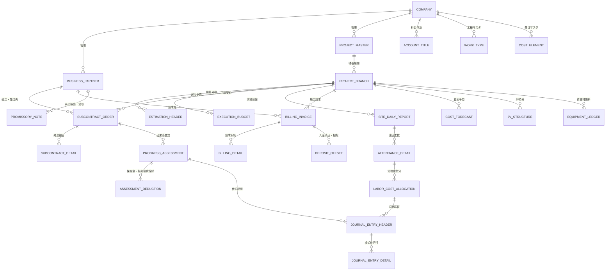
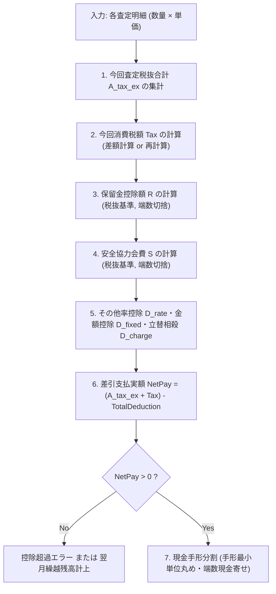
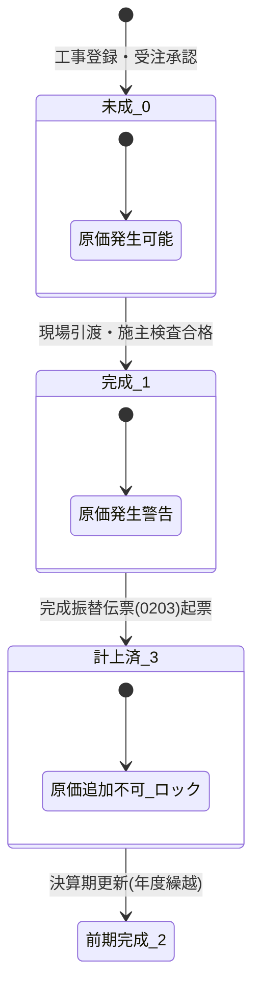

# 建設業特有業務データモデル 完全実装仕様書（v2.0）
## — Zero-Knowledge AI / Full-Stack Engineer Implementation Reference —

---

## 1. アーキテクチャ原則とデータ設計基準

### 1.1 本書の設計思想
本書は、建設業のドメイン知識を全く持たない自律型AIコーディングエージェントまたはフルスタックエンジニアが、**外部への質問や推測による補完を一切行わずに、本仕様書のみからプロダクション品質の建設業基幹システム（DBスキーマ、計算エンジン、ステートマシン、API、排他制御）を実装できること**を目的とした完全仕様書である。

### 1.2 必須データ型・精度・マルチテナント基準
* **マルチテナント複合主キーの義務化**：
  すべてのテーブルは、最上位パーティションキーとして会社コード（`company_code CHAR(4)`）を複合主キーの第1構成要素とする。これにより、グループ企業・複数法人運用時のデータ完全分離と連結集計を保証する。
* **通貨・金額型の厳密定義（浮動小数点数の完全禁止）**：
  * **金額（Currency）**：`NUMERIC(15,0)`（日本円は原則整数。最大 `999,999,999,999` を許容）。
  * **単価・数量・工数・進捗率（Rate / Quantity / Unit Price）**：`NUMERIC(15,3)`（小数点以下3桁まで保持）。
  * 会計・査定・原価計算において、IEEE 754浮動小数点数（`FLOAT`, `DOUBLE`）の使用は**厳格に禁止**する。固定小数点型（Exact Numeric）のみを採用すること。
* **履歴・改定管理（Immutable Revision Pattern）**：
  見積、実行予算、請負契約、下請注文書は、承認後の直接更新（インプレースUPDATE）を禁止し、履歴番号（`history_no SMALLINT`）をインクリメントした新レコードを発行する。

---

## 2. 全体概念ERモデル（Global Architecture）



---

## 3. コアエンティティ完全定義（DDL・データディクショナリ）

### 3.1 統合取引先（ビジネスパートナー）マスタ
建設業では、下請業者に対して資材を立替販売したり、施主が同時に協力会社であるケースが頻発するため、**得意先・仕入先・外注先・銀行を分離せず、多重ロールフラグを持つ単一マスタ**で管理する。

#### テーブル名：`business_partners`
| カラム物理名 | 型・制約 | 必須 | 業務論理名・制約解説 |
| :--- | :--- | :---: | :--- |
| `company_code` | `CHAR(4)` | **PK** | 会社コード（例：`0000`） |
| `partner_code` | `VARCHAR(8)` | **PK** | 取引先コード |
| `partner_name` | `VARCHAR(100)` | YES | 正式名称（例：株式会社佐藤組） |
| `partner_short_name` | `VARCHAR(40)` | YES | 略称（帳票・一覧表示用） |
| `postal_code` | `VARCHAR(8)` | NO | 郵便番号（ハイフン含む/除外統一） |
| `address_code` | `CHAR(5)` | NO | 全国地方公共団体コード準拠 |
| `address_line1` | `VARCHAR(100)` | NO | 都道府県・市区町村 |
| `address_line2` | `VARCHAR(100)` | NO | 町名・番地・ビル名 |
| `phone_number` | `VARCHAR(20)` | NO | 電話番号 |
| `fax_number` | `VARCHAR(20)` | NO | FAX番号 |
| `is_customer` | `BOOLEAN` | YES | 得意先フラグ（施主・元請） |
| `is_subcontractor` | `BOOLEAN` | YES | 外注先フラグ（専門工事業者） |
| `is_supplier` | `BOOLEAN` | YES | 資材仕入先フラグ |
| `is_employee` | `BOOLEAN` | YES | 社員フラグ（立替経費精算用） |
| `is_bank` | `BOOLEAN` | YES | 銀行フラグ |
| `is_taxable_vendor` | `BOOLEAN` | YES | インボイス適格請求書発行事業者フラグ |
| `invoice_reg_number`| `VARCHAR(14)` | NO | インボイス登録番号（T + 13桁） |
| `closing_day` | `SMALLINT` | YES | 締日（`1`〜`30`, `99`:末日） |
| `payment_month_offset`| `SMALLINT` | YES | 支払月オフセット（`0`:当月, `1`:翌月, `2`:翌々月） |
| `payment_day` | `SMALLINT` | YES | 支払日（`1`〜`30`, `99`:末日） |
| `cash_ratio` | `NUMERIC(5,2)`| YES | 現金支払割合（0.00〜100.00%） |
| `promissory_note_ratio`| `NUMERIC(5,2)`| YES | 手形支払割合（0.00〜100.00%） |
| `note_sight_days` | `SMALLINT` | YES | 手形サイト日数（例：`90`, `120`） |
| `safety_assoc_rate_num`| `NUMERIC(5,2)`| YES | 安全協力会費率（分子） |
| `safety_assoc_rate_den`| `NUMERIC(5,2)`| YES | 安全協力会費率（分母：通常`100`または`1000`） |
| `is_deleted` | `BOOLEAN` | YES | 論理削除フラグ |

---

### 3.2 工事・契約・施工体制エンティティ

#### テーブル名：`project_masters`（工事基本マスタ）
| カラム物理名 | 型・制約 | 必須 | 業務論理名・制約解説 |
| :--- | :--- | :---: | :--- |
| `company_code` | `CHAR(4)` | **PK** | 会社コード |
| `project_code` | `VARCHAR(10)` | **PK** | 工事コード（プロジェクト親識別子） |
| `project_name` | `VARCHAR(120)` | YES | 工事正式名称 |
| `project_short_name`| `VARCHAR(40)` | YES | 工事略称 |
| `construction_type`| `CHAR(4)` | YES | 工事種別コード（新築、改修、解体等） |
| `doken_type` | `CHAR(1)` | YES | 土建区分（`1`:土木, `2`:建築, `9`:その他） |
| `honzatsu_type` | `CHAR(1)` | YES | 本雑区分（`1`:本工事, `2`:雑工事） |
| `kanmin_type1` | `CHAR(1)` | YES | 官民区分1（`1`:官庁, `2`:民間） |
| `kanmin_type2` | `CHAR(1)` | YES | 官民区分2（`1`:国, `2`:公社, `3`:都道府県, `4`:市区町村, `5`:準官） |
| `order_format` | `CHAR(1)` | YES | 受注形態（`1`:単独, `2`:JV） |
| `jv_type` | `CHAR(1)` | NO | JV形態（`1`:特定甲, `2`:特定乙, `3`:経常甲, `4`:経常乙, `9`:他） |
| `contract_method` | `CHAR(1)` | YES | 受注方法（`1`:特命, `2`:指名, `7`:一般競争, `8`:随意, `9`:他） |
| `is_common_cost` | `BOOLEAN` | YES | 共通原価配賦対象工事フラグ（本社経費等を集約する工事） |

#### テーブル名：`project_branches`（工事枝番・施工契約管理）
追加工事・設計変更は別レコードとして枝番（3桁）で独立管理し、原価・請負額を個別把握する。
| カラム物理名 | 型・制約 | 必須 | 業務論理名・制約解説 |
| :--- | :--- | :---: | :--- |
| `company_code` | `CHAR(4)` | **PK, FK** | 会社コード |
| `project_code` | `VARCHAR(10)` | **PK, FK** | 工事コード（`project_masters` 参照） |
| `branch_code` | `CHAR(3)` | **PK** | 工事枝コード（本工事=`000`, 追加=`001`〜`999`） |
| `completion_status`| `CHAR(1)` | YES | 完成状態（`0`:未成, `1`:完成, `2`:前期完成, `3`:計上済） |
| `revenue_recognition_method` | `CHAR(1)` | YES | 完成計上区分（`0`:工事完成基準, `1`:工事進行基準） |
| `tax_calc_timing` | `CHAR(1)` | YES | 消費税計上タイミング（`0`:発生ベース, `1`:完成ベース） |
| `managing_dept_code`| `CHAR(4)` | YES | 工事担当部門コード（原価帰属部門） |
| `sales_dept_code` | `CHAR(4)` | YES | 営業担当部門コード |
| `site_manager_code`| `VARCHAR(8)` | YES | 現場代理人社員コード |
| `supervising_engineer_code` | `VARCHAR(8)` | NO | 監理技術者コード（下請発注総額4,500万円以上時必須） |
| `chief_engineer_code` | `VARCHAR(8)` | NO | 主任技術者コード（一般工事） |
| `contract_start_date`| `DATE` | YES | 契約工期（開始） |
| `contract_end_date` | `DATE` | YES | 契約工期（終了） |
| `internal_start_date`| `DATE` | YES | 社内工期（開始：現場施工着手日） |
| `internal_end_date` | `DATE` | YES | 社内工期（終了：施工目標完了日） |
| `actual_completion_date` | `DATE` | NO | 完成確定日（施主検査合格・引渡日） |
| `defect_liability_date` | `DATE` | NO | 瑕疵担保満了日 |
| `client_partner_code` | `VARCHAR(8)` | YES | 施主コード（`business_partners` 参照） |
| `orderer_partner_code` | `VARCHAR(8)` | YES | 発注元得意先コード（請求先） |
| `current_contract_amount_tax_ex` | `NUMERIC(15,0)` | YES | 最新請負金額（税抜） |
| `current_contract_tax_amount` | `NUMERIC(15,0)` | YES | 最新請負消費税額 |
| `estimated_total_cost` | `NUMERIC(15,0)` | YES | 進行基準見積総原価（進捗率の分母） |
| `approval_status` | `CHAR(1)` | YES | 承認状態（`0`:未承認, `3`:申請中, `2`:確認, `1`:承認, `9`:否認） |

---

### 3.3 見積・積算・実行予算体系エンティティ

#### テーブル名：`estimation_headers`（積算見積ヘッダ）
| カラム物理名 | 型・制約 | 必須 | 業務論理名・制約解説 |
| :--- | :--- | :---: | :--- |
| `company_code` | `CHAR(4)` | **PK** | 会社コード |
| `estimate_number` | `VARCHAR(12)` | **PK** | 見積番号（例：`2026-EST-001`） |
| `estimate_history_no`| `SMALLINT` | **PK** | 見積履歴改定番号（当初=`0`, 改定=`1`...） |
| `project_code` | `VARCHAR(10)` | NO, FK | 紐付工事コード（未確定時はNULL可） |
| `customer_code` | `VARCHAR(8)` | YES, FK | 見積提出先得意先コード |
| `estimate_date` | `DATE` | YES | 見積提出日 |
| `estimate_amount_tax_ex` | `NUMERIC(15,0)` | YES | 見積総額（税抜） |
| `estimate_cost_amount` | `NUMERIC(15,0)` | YES | 見積原価総額 |
| `expected_profit_rate` | `NUMERIC(5,2)` | YES | 予定粗利率（%） |
| `deal_status` | `CHAR(1)` | YES | 商談状況（`0`:見積中, `1`:受注確定, `2`:失注, `9`:保留） |

#### テーブル名：`estimation_details`（積算見積明細・最大10階層）
建設業の積算内訳書は「表紙 $\to$ 内訳書 $\to$ 明細書 $\to$ 代価表」のように最大10階層（`MitsumoriBunruiCode`）のツリー構造を持つ。
| カラム物理名 | 型・制約 | 必須 | 業務論理名・制約解説 |
| :--- | :--- | :---: | :--- |
| `company_code` | `CHAR(4)` | **PK, FK** | 会社コード |
| `estimate_number` | `VARCHAR(12)` | **PK, FK** | 見積番号 |
| `estimate_history_no`| `SMALLINT` | **PK, FK** | 見積改定番号 |
| `line_no` | `INTEGER` | **PK** | 行番号（1〜） |
| `parent_line_no` | `INTEGER` | NO | 親階層行番号（自己参照FKによるツリー構造） |
| `hierarchy_level` | `SMALLINT` | YES | 階層レベル（`1`〜`10`） |
| `record_type` | `CHAR(2)` | YES | レコード区分（`01`:明細, `11`:労務費, `21`:諸経費1, `22`:諸経費2, `23`:諸経費3） |
| `work_type_code` | `VARCHAR(12)` | NO, FK | 工種コード |
| `item_name` | `VARCHAR(80)` | YES | 品名・項目名称 |
| `specification` | `VARCHAR(80)` | NO | 規格・仕様 |
| `quantity` | `NUMERIC(15,3)`| YES | 数量 |
| `unit` | `VARCHAR(10)` | YES | 単位 |
| `unit_price` | `NUMERIC(15,3)`| YES | 提出単価 |
| `amount` | `NUMERIC(15,0)`| YES | 提出金額（= 数量 × 単価 四捨五入） |
| `cost_unit_price` | `NUMERIC(15,3)`| YES | 原価単価 |
| `cost_amount` | `NUMERIC(15,0)`| YES | 原価金額 |

#### テーブル名：`work_types`（工種マスタ）
工種コードは12桁の構造化コードであり、大工種(4桁)・中工種(4桁)・小工種(4桁)の3階層ツリーを構成する。
| カラム物理名 | 型・制約 | 必須 | 業務論理名・制約解説 |
| :--- | :--- | :---: | :--- |
| `company_code` | `CHAR(4)` | **PK** | 会社コード |
| `work_type_code` | `VARCHAR(12)` | **PK** | 工種コード（例：`001000200030`） |
| `hierarchy_level`| `SMALLINT` | YES | 階層レベル（`1`:大工種, `2`:中工種, `3`:小工種） |
| `major_code` | `CHAR(4)` | YES | 大工種コード（例：`0010` 躯体工事） |
| `middle_code` | `CHAR(4)` | NO | 中工種コード（例：`0020` 型枠工事） |
| `minor_code` | `CHAR(4)` | NO | 小工種コード（例：`0030` スラブ型枠） |
| `work_type_name` | `VARCHAR(60)` | YES | 工種名称 |

#### テーブル名：`cost_elements`（費目マスタ）
| カラム物理名 | 型・制約 | 必須 | 業務論理名・制約解説 |
| :--- | :--- | :---: | :--- |
| `company_code` | `CHAR(4)` | **PK** | 会社コード |
| `cost_element_code`| `CHAR(4)` | **PK** | 費目コード（例：`0100` 材料費, `0300` 外注費） |
| `element_category` | `CHAR(2)` | YES | 原価要素大区分（`10`:材料, `20`:労務, `30`:外注, `40`:経費, `50`:機械損料） |
| `cost_element_name`| `VARCHAR(40)` | YES | 費目名称 |
| `default_debit_account` | `CHAR(4)` | YES | デフォルト借方勘定科目コード（未成工事支出金科目） |

#### テーブル名：`execution_budgets`（実行予算ヘッダ）
| カラム物理名 | 型・制約 | 必須 | 業務論理名・制約解説 |
| :--- | :--- | :---: | :--- |
| `company_code` | `CHAR(4)` | **PK, FK** | 会社コード |
| `project_code` | `VARCHAR(10)` | **PK, FK** | 工事コード |
| `branch_code` | `CHAR(3)` | **PK, FK** | 工事枝コード |
| `budget_history_no`| `SMALLINT` | **PK** | 予算履歴番号（当初=`0`, 改定=`1`, `2`...） |
| `budget_created_date` | `DATE` | YES | 予算作成年月日 |
| `total_budget_amount` | `NUMERIC(15,0)` | YES | 実行予算総額（税抜） |
| `target_gross_profit_rate`| `NUMERIC(5,2)` | YES | 目標粗利率（%） |
| `approval_status` | `CHAR(1)` | YES | 承認状況（`1`:承認済 のみ発注可能） |
| `notes` | `TEXT` | NO | 予算注記（施工計画・特記事項） |

#### テーブル名：`execution_budget_details`（実行予算明細）
| カラム物理名 | 型・制約 | 必須 | 業務論理名・制約解説 |
| :--- | :--- | :---: | :--- |
| `company_code` | `CHAR(4)` | **PK, FK** | 会社コード |
| `project_code` | `VARCHAR(10)` | **PK, FK** | 工事コード |
| `branch_code` | `CHAR(3)` | **PK, FK** | 工事枝コード |
| `budget_history_no`| `SMALLINT` | **PK, FK** | 予算履歴番号 |
| `line_no` | `INTEGER` | **PK** | 行番号（1〜） |
| `work_type_code` | `VARCHAR(12)` | YES, FK | 工種コード（小工種推奨） |
| `cost_element_code`| `CHAR(4)` | YES, FK | 費目コード |
| `item_name` | `VARCHAR(60)` | YES | 細目名称（作業項目・資材名） |
| `specification` | `VARCHAR(60)` | NO | 規格・仕様（例：`D16 SD345`） |
| `unit` | `VARCHAR(10)` | YES | 単位（例：`m3`, `t`, `m2`, `人`, `式`） |
| `planned_quantity`| `NUMERIC(15,3)`| YES | 予算数量 |
| `planned_unit_price`| `NUMERIC(15,3)`| YES | 予算単価 |
| `planned_amount` | `NUMERIC(15,0)`| YES | 予算金額（= 数量 × 単価 四捨五入） |

---

### 3.4 下請発注・出来高査定・支払控除エンティティ

#### テーブル名：`subcontract_orders`（下請注文書ヘッダ）
| カラム物理名 | 型・制約 | 必須 | 業務論理名・制約解説 |
| :--- | :--- | :---: | :--- |
| `company_code` | `CHAR(4)` | **PK, FK** | 会社コード |
| `order_number` | `VARCHAR(12)` | **PK** | 注文書番号（例：`2026-04-0012`） |
| `order_history_no` | `SMALLINT` | **PK** | 発注改定番号（当初=`0`, 変更=`1`...） |
| `project_code` | `VARCHAR(10)` | YES, FK | 工事コード |
| `branch_code` | `CHAR(3)` | YES, FK | 工事枝コード |
| `subcontractor_code` | `VARCHAR(8)` | YES, FK | 下請業者取引先コード |
| `order_date` | `DATE` | YES | 発注年月日 |
| `work_start_date` | `DATE` | YES | 施工着手予定日 |
| `work_end_date` | `DATE` | YES | 施工完了予定日 |
| `order_type` | `CHAR(1)` | YES | 発注区分（`1`:全額契約, `2`:変更増減額） |
| `is_unit_price_contract`| `BOOLEAN` | YES | 単価契約フラグ（数量未定常用契約） |
| `order_amount_tax_ex` | `NUMERIC(15,0)` | YES | 発注契約金額（税抜） |
| `order_tax_amount` | `NUMERIC(15,0)` | YES | 発注消費税額 |
| `closing_day` | `SMALLINT` | YES | 査定締日（下請個別条件） |
| `cash_ratio` | `NUMERIC(5,2)` | YES | 現金支払比率（%） |
| `promissory_note_ratio`| `NUMERIC(5,2)` | YES | 手形支払比率（%） |
| `note_sight_days` | `SMALLINT` | YES | 手形サイト日数 |
| `retainage_rate_num` | `NUMERIC(5,2)` | YES | 保留金率（分子） |
| `retainage_rate_den` | `NUMERIC(5,2)` | YES | 保留金率（分母：通常`100`） |
| `safety_assoc_rate_num`| `NUMERIC(5,2)` | YES | 安全協力会費率（分子） |
| `safety_assoc_rate_den`| `NUMERIC(5,2)` | YES | 安全協力会費率（分母：通常`1000`） |
| `acknowledgement_status`| `CHAR(1)` | YES | 請書受取状態（`0`:未着, `1`:受取済） |
| `acknowledgement_date` | `DATE` | NO | 請書回収年月日 |
| `order_status` | `CHAR(1)` | YES | 状態（`0`:起票, `1`:承認済, `9`:取消） |

#### テーブル名：`progress_assessments`（月次出来高査定ヘッダ）
| カラム物理名 | 型・制約 | 必須 | 業務論理名・制約解説 |
| :--- | :--- | :---: | :--- |
| `company_code` | `CHAR(4)` | **PK, FK** | 会社コード |
| `assessment_no` | `VARCHAR(12)` | **PK** | 査定伝票番号 |
| `order_number` | `VARCHAR(12)` | YES, FK | 注文書番号 |
| `order_history_no` | `SMALLINT` | YES, FK | 発注履歴番号 |
| `subcontractor_code` | `VARCHAR(8)` | YES, FK | 下請業者コード |
| `project_code` | `VARCHAR(10)` | YES, FK | 工事コード |
| `branch_code` | `CHAR(3)` | YES, FK | 工事枝コード |
| `assessment_year_month`| `CHAR(6)` | YES | 査定対象年月（YYYYMM） |
| `assessment_closing_date`| `DATE` | YES | 査定締日付 |
| `curr_assessed_amount_tax_ex`| `NUMERIC(15,0)` | YES | 今回出来高査定額（税抜） |
| `curr_assessed_tax_amount` | `NUMERIC(15,0)` | YES | 今回査定消費税額 |
| `accum_assessed_amount_tax_ex`| `NUMERIC(15,0)` | YES | 累計出来高査定額（税抜） |
| `curr_retainage_deduction` | `NUMERIC(15,0)` | YES | 今回保留金控除額 |
| `curr_safety_assoc_deduction` | `NUMERIC(15,0)` | YES | 今回安全協力会費控除額 |
| `curr_other_rate_deductions` | `NUMERIC(15,0)` | YES | その他率控除合計額 |
| `curr_fixed_deductions` | `NUMERIC(15,0)` | YES | その他固定額控除合計額 |
| `curr_chargeback_offset` | `NUMERIC(15,0)` | YES | 現場資材・食堂等立替相殺額 |
| `net_payment_amount` | `NUMERIC(15,0)` | YES | 差引支払実金額（税込出来高 - 全控除） |
| `cash_payment_amount` | `NUMERIC(15,0)` | YES | 現金支払額（銀行振込額） |
| `note_payment_amount` | `NUMERIC(15,0)` | YES | 手形振出額（またはファクタリング額） |
| `payment_due_date` | `DATE` | YES | 支払予定期日 |
| `voucher_issued` | `BOOLEAN` | YES | 会計仕訳起票済フラグ |

---

### 3.5 施主請求・入金消込・手形管理エンティティ

#### テーブル名：`billing_invoices`（施主請求書ヘッダ）
| カラム物理名 | 型・制約 | 必須 | 業務論理名・制約解説 |
| :--- | :--- | :---: | :--- |
| `company_code` | `CHAR(4)` | **PK, FK** | 会社コード |
| `invoice_number` | `VARCHAR(12)` | **PK** | 請求書番号（例：`2026-INV-001`） |
| `project_code` | `VARCHAR(10)` | YES, FK | 工事コード |
| `branch_code` | `CHAR(3)` | YES, FK | 工事枝コード |
| `customer_code` | `VARCHAR(8)` | YES, FK | 請求先得意先コード |
| `billing_date` | `DATE` | YES | 請求締日・発行日 |
| `expected_deposit_date` | `DATE` | YES | 入金期日（約定支払日） |
| `previous_billed_amount`| `NUMERIC(15,0)` | YES | 前回迄請求累計額 |
| `previous_carried_balance`| `NUMERIC(15,0)` | YES | 前回繰越未回収残高 |
| `current_billed_tax_ex` | `NUMERIC(15,0)` | YES | 今回請求額（税抜出来高・完成高） |
| `current_tax_amount` | `NUMERIC(15,0)` | YES | 今回消費税額 |
| `current_total_billed` | `NUMERIC(15,0)` | YES | 今回請求合計額（税込） |
| `invoice_format` | `CHAR(1)` | YES | 請求書書式（`1`:鑑＋明細, `2`:繰越鑑） |
| `send_to_type` | `CHAR(1)` | YES | 送付先区分（`0`:本社経理, `1`:現場詰所, `9`:他） |
| `is_cleared` | `BOOLEAN` | YES | 入金完済フラグ |

#### テーブル名：`deposit_offsets`（入金消込・相殺内訳）
| カラム物理名 | 型・制約 | 必須 | 業務論理名・制約解説 |
| :--- | :--- | :---: | :--- |
| `company_code` | `CHAR(4)` | **PK, FK** | 会社コード |
| `deposit_voucher_no` | `VARCHAR(12)` | **PK** | 入金伝票番号 |
| `invoice_number` | `VARCHAR(12)` | YES, FK | 消込対象請求書番号 |
| `deposit_date` | `DATE` | YES | 入金年月日 |
| `deposit_category` | `CHAR(2)` | YES | 入金種別（`01`:現金, `02`:振込, `03`:手形, `05`:相殺, `08`:値引, `19`:ファクタリング） |
| `deposit_amount` | `NUMERIC(15,0)` | YES | 入金額・消込額 |
| `bank_transfer_fee` | `NUMERIC(15,0)` | YES | 振込手数料差引額（施主側控除時） |
| `chargeback_offset` | `NUMERIC(15,0)` | YES | 下請売掛買掛相殺額 |
| `note_number` | `VARCHAR(20)` | NO | 受取手形番号（手形受取時のみ） |

#### テーブル名：`promissory_notes`（手形・電子記録債権マスタ）
| カラム物理名 | 型・制約 | 必須 | 業務論理名・制約解説 |
| :--- | :--- | :---: | :--- |
| `company_code` | `CHAR(4)` | **PK, FK** | 会社コード |
| `note_number` | `VARCHAR(20)` | **PK** | 手形番号 / 電子記録債権番号 |
| `note_type` | `CHAR(1)` | YES | 手形種類（`1`:受取手形, `2`:支払手形） |
| `face_value_amount` | `NUMERIC(15,0)` | YES | 額面金額 |
| `issue_date` | `DATE` | YES | 振出日 |
| `maturity_due_date` | `DATE` | YES | 支払期日（満期日） |
| `drawer_partner_code` | `VARCHAR(8)` | YES, FK | 振出人取引先コード |
| `draw_bank_code` | `CHAR(4)` | YES | 振出銀行コード |
| `draw_branch_code` | `CHAR(3)` | YES | 振出支店コード |
| `note_status` | `CHAR(1)` | YES | 異動状態（`0`:保管中, `1`:取立済, `2`:割引, `3`:裏書譲渡, `4`:不渡, `9`:取消） |

---

### 3.6 共同企業体（JV）管理エンティティ

#### テーブル名：`jv_project_definitions`（JV共同企業体定義）
| カラム物理名 | 型・制約 | 必須 | 業務論理名・制約解説 |
| :--- | :--- | :---: | :--- |
| `company_code` | `CHAR(4)` | **PK, FK** | 会社コード |
| `project_code` | `VARCHAR(10)` | **PK, FK** | 工事コード（`project_masters` 参照） |
| `jv_format_type` | `CHAR(1)` | YES | JV形態（`1`:特定甲, `2`:特定乙, `3`:経常甲, `4`:経常乙） |
| `sponsor_partner_code`| `VARCHAR(8)` | YES, FK | 幹事会社（スポンサー）コード |
| `total_capital_amount`| `NUMERIC(15,0)` | YES | 協定出資金総額 |

#### テーブル名：`jv_constituent_members`（JV構成員・出資比率）
| カラム物理名 | 型・制約 | 必須 | 業務論理名・制約解説 |
| :--- | :--- | :---: | :--- |
| `company_code` | `CHAR(4)` | **PK, FK** | 会社コード |
| `project_code` | `VARCHAR(10)` | **PK, FK** | 工事コード |
| `member_partner_code` | `VARCHAR(8)` | **PK, FK** | 構成員企業コード |
| `equity_share_ratio` | `NUMERIC(5,2)` | YES | 出資比率（構成全社の合計が厳密に100.00%） |
| `is_sponsor` | `BOOLEAN` | YES | 幹事社フラグ |
| `committed_capital` | `NUMERIC(15,0)` | YES | 出資割当額（= 総出資金 × 出資比率） |

---

### 3.7 仮設資機材・損料管理エンティティ

#### テーブル名：`construction_equipment_masters`（資機材マスタ）
| カラム物理名 | 型・制約 | 必須 | 業務論理名・制約解説 |
| :--- | :--- | :---: | :--- |
| `company_code` | `CHAR(4)` | **PK** | 会社コード |
| `equipment_code` | `VARCHAR(10)` | **PK** | 資機材コード |
| `equipment_name` | `VARCHAR(60)` | YES | 資機材名称（例：枠組足場建枠、単管パイプ） |
| `specification` | `VARCHAR(40)` | NO | 規格 |
| `unit` | `VARCHAR(10)` | YES | 単位（本、枚、基等） |
| `daily_rent_price` | `NUMERIC(15,3)`| YES | 標準日単価 |
| `monthly_rent_price` | `NUMERIC(15,3)`| YES | 標準月単価 |
| `loss_settlement_price`| `NUMERIC(15,0)`| YES | 滅失弁済基準価格（現場破損・紛失時請求額） |

#### テーブル名：`equipment_site_movements`（資機材入出庫・現場移動）
| カラム物理名 | 型・制約 | 必須 | 業務論理名・制約解説 |
| :--- | :--- | :---: | :--- |
| `company_code` | `CHAR(4)` | **PK, FK** | 会社コード |
| `movement_slip_no` | `VARCHAR(12)` | **PK** | 移動伝票番号 |
| `equipment_code` | `VARCHAR(10)` | YES, FK | 資機材コード |
| `source_location` | `VARCHAR(20)` | YES | 移動元（資材置場コード または 払出元工事コード） |
| `dest_project_code` | `VARCHAR(10)` | YES, FK | 投入先工事コード |
| `dest_branch_code` | `CHAR(3)` | YES, FK | 投入先工事枝コード |
| `movement_date` | `DATE` | YES | 移動年月日 |
| `movement_type` | `CHAR(2)` | YES | 移動区分（`01`:購入, `02`:出庫, `03`:返納, `04`:滅失, `08`:整備, `09`:運賃, `10`:精算） |
| `quantity` | `NUMERIC(15,3)`| YES | 移動数量 |
| `freight_fee` | `NUMERIC(15,0)`| YES | 横持ち運賃 |
| `maintenance_fee` | `NUMERIC(15,0)`| YES | 整備ケレン費用 |

---

## 4. 決定論的計算エンジン仕様（Deterministic Business Algorithms）

AIや開発者が計算誤差・丸め差異・境界条件の解釈ミスを起こさないよう、数式・処理順序・端数処理ルールを厳密に規定する。

### 4.1 出来高査定および控除金額の計算パイプライン



#### Step 1：今回査定税抜金額の算出
各工種・細目明細行 $i$ について：
$$
\text{LineAmount}_i = \text{round}(\text{AssessedQty}_i \times \text{ContractUnitPrice}_i)
$$
$$
A_{\text{tax\_ex}} = \sum_{i} \text{LineAmount}_i
$$

#### Step 2：消費税額の計算（端数累積差異の完全防止）
発注残消費税設定方法区分（`HaccyuuzanSyouhizeigakuSetteiHouhou`）に従い分岐する：
* **`0:差額計算`（最終査定時または累計管理時推奨）**：
  $$
  \text{AccumTax}_{\text{curr}} = \text{floor}\left( \text{AccumAssessedTaxEx}_{\text{curr}} \times \text{TaxRate} \right)
  $$
  $$
  \text{Tax}_{\text{curr}} = \text{AccumTax}_{\text{curr}} - \text{AccumTax}_{\text{prev}}
  $$
  ※この方式を採用することで、12ヶ月等の長期分割査定において、月ごとの端数切捨てによる1〜数円の累積税差異を完全にゼロにし、最終契約額と完全に一致させる。
* **`1:再計算`（都度独立計算時）**：
  $$
  \text{Tax}_{\text{curr}} = \text{floor}\left( A_{\text{tax\_ex}} \times \text{TaxRate} \right)
  $$

#### Step 3：特有控除項目の計算式と端数規則
各控除項目の基準額は、特段の契約指定がない限り**税抜査定額 $A_{\text{tax\_ex}}$** とする。
1. **保留金控除額 $R$**（端数処理：切り捨て）：
   $$
   R = \text{floor}\left( A_{\text{tax\_ex}} \times \frac{\text{RetainageRateNum}}{\text{RetainageRateDen}} \right)
   $$
2. **安全協力会費控除額 $S$**（端数処理：切り捨て）：
   $$
   S = \text{floor}\left( A_{\text{tax\_ex}} \times \frac{\text{SafetyRateNum}}{\text{SafetyRateDen}} \right)
   $$
3. **その他率控除合計 $D_{\text{rate}}$**：
   $$
   D_{\text{rate}} = \sum_{k=1}^{5} \text{floor}\left( A_{\text{tax\_ex}} \times \frac{\text{RateNum}_k}{\text{RateDen}_k} \right)
   $$
4. **総控除額 $D_{\text{total}}$**：
   $$
   D_{\text{total}} = R + S + D_{\text{rate}} + \sum_{m=1}^{5} \text{FixedAmount}_m + \text{ChargebackOffset}
   $$

#### Step 4：差引支払実金額および現金・手形分割規則
$$
\text{NetPay} = (A_{\text{tax\_ex}} + \text{Tax}_{\text{curr}}) - D_{\text{total}}
$$
* **制約条件**：$\text{NetPay} < 0$（控除超過）の場合、システムは警告を発行し、支払額を0円とした上で超過控除額を「業者未収立替金」として翌月繰越管理テーブルに退避する。
* **現金・手形分割と丸め寄せ（Rounding Reconciliation）**：
  手形は商慣行上、千円未満または1万円未満の端数振出を行わない。
  $$
  \text{RawNoteAmount} = \text{NetPay} \times \frac{\text{PromissoryNoteRatio}}{100}
  $$
  $$
  \text{NotePayment} = \text{floor}\left( \frac{\text{RawNoteAmount}}{\text{NoteRoundingUnit}} \right) \times \text{NoteRoundingUnit}
  $$
  $$
  \text{CashPayment} = \text{NetPay} - \text{NotePayment}
  $$
  ※手形の端数は**すべて現金側に加算統合**し、1円のズレも生じさせない。

---

### 4.2 労務費出面按分アルゴリズム
複数現場に従事した直営作業員の日給・工数を各現場へ原価配賦する計算モデル。

#### 計算入力パラメータ
* 作業員 $W$ の当月確定賃金総額：$TotalWage_W$
* 作業員 $W$ の各現場 $j$ における従事工数：$Hours_{W, j}$
* 総工数：$TotalHours_W = \sum_{j} Hours_{W, j}$

#### 配賦計算式
現場 $j$ への配賦原価 $Cost_{W, j}$：
$$
Cost_{W, j} = \text{floor}\left( TotalWage_W \times \frac{Hours_{W, j}}{TotalHours_W} \right)
$$
#### 端数調整ルール（`KoujiWariaiHasuuTyousei`）
配賦差額 $\Delta = TotalWage_W - \sum_{j} Cost_{W, j}$ の寄先：
* `0:最多工数工事`：$\max_j (Hours_{W, j})$ となる現場の配賦額に $\Delta$ を加算。
* `1:最終工事`：日報入力順の最終現場に $\Delta$ を加算。

---

### 4.3 共通原価配賦アルゴリズム（Overhead Cost Allocation）
現場共通仮設、支店管理費等の共通原価工事（`is_common_cost = true`）にプールされた原価を、月末バッチで各稼働工事へ配賦する。

#### 配賦基準（Allocation Basis）
当月の各稼働工事 $k$ における **直接原価発生額累計 $DirectCost_k$**（または請負金額比）。
$$
Ratio_k = \frac{DirectCost_k}{\sum_{m} DirectCost_m}
$$
配賦額：
$$
AllocatedAmount_k = \text{floor}\left( TotalPoolAmount \times Ratio_k \right)
$$
端数差額（$TotalPoolAmount - \sum AllocatedAmount_k$）は、端数調整区分（`KyoutsuuGenkaAnbunHasuuCyousei`）に従い、当月直接原価が `0:最大金額` の工事に加算してプール残高を厳密に0円とする。

---

### 4.4 工事進行基準（原価比例法進捗率計算・着地予想原価分母算定）
進行基準適用工事（`revenue_recognition_method = 1`）における決算時売上認識：
* **期末迄実際原価累計**：$C_{\text{actual}}$
* **着地見積総原価**：$C_{\text{estimated}}$（発注確定済契約高 + 未発注見込予想高）
* **工事進捗度**：
  $$
  r = \min\left(1.000, \frac{C_{\text{actual}}}{C_{\text{estimated}}}\right)
  $$
* **当期認識完成工事高（売上）**：
  $$
  \text{Revenue}_{\text{curr}} = \text{round}(P_{\text{contract}} \times r) - \text{Revenue}_{\text{prev}}
  $$

---

## 5. 建設業会計・仕訳・振替エンジン

### 5.1 勘定科目標準体系
一般会計と異なり、仕掛品勘定は「未成工事支出金」、売上は「完成工事高」、売上原価は「完成工事原価」を使用する。

```mermaid
flowchart LR
    subgraph 工事中（未成期間）
        A["資材・下請原価発生"] -->|借方| B["1120: 未成工事支出金<br/>(資産)"]
        C["施主中間前受金"] -->|貸方| D["2110: 未成工事受入金<br/>(負債)"]
    end
    subgraph 工事完成・引渡時
        B -->|完成振替伝票 0203| E["5110: 完成工事原価<br/>(費用)"]
        D -->|売上振替伝票 0631| F["4110: 完成工事高<br/>(収益)"]
    end
```

### 5.2 自動仕訳トリガーと仕訳パターンマトリクス

| イベントトリガー | 伝票区分 | 借方勘定（Debit） | 貸方勘定（Credit） | 摘要・補足 |
| :--- | :---: | :--- | :--- | :--- |
| **下請査定確定** | `0135` | 未成工事支出金（外注費）<br>仮払消費税 | 工事未払金（差引支払額）<br>保留金（負債）<br>預り金（安全協力会費） | 保留金・協力会費は貸方負債に分離留保 |
| **完成引渡（完成基準）** | `0203` | 完成工事原価（全累積額） | 未成工事支出金（全累積額） | 工事毎に未成残高をゼロクリア |
| **施主請求発行（完成時）**| `0631` | 完成工事未収入金（売掛金） | 完成工事高（税抜売上）<br>仮受消費税 | 請求鑑発行時に起票 |
| **施主着工金受取** | `0633` | 普通預金 | 未成工事受入金（前受金） | 完成時に完成工事高へ振替 |
| **進行基準期末計上** | `0208` | 完成工事未収入金（進捗部分）<br>完成工事原価（当期発生分） | 完成工事高（進捗率比例分）<br>未成工事支出金（当期発生分） | 原価比例法進捗率 $r$ に基づく計上 |
| **保留解除（竣工後支払）**| `0301` | 保留金（負債の取崩） | 工事未払金（支払先業者） | 検査合格後の保留金精算 |
| **出面労務原価振替** | `0551` | 未成工事支出金（労務費） | 労務費振替（または未払給与） | 日報工数按分結果の一括振替 |
| **JV出資金振替** | `1151` | 未成工事支出金（自社持分） | 共同企業体出資金（幹事社相殺） | JV出資精算時の自動仕訳 |
| **資機材損料振替** | `1451` | 未成工事支出金（経費・機械）| 資機材損料売上（社内損料振替） | 現場設置日数連動の損料計上 |

---

## 6. ステートマシンと業務ガード制約（Lifecycle & Validation Rules）

AIが不正な更新APIや画面遷移を実装しないよう、エンティティの状態遷移および操作ガード条件をテーブル形式で厳密に定義する。

### 6.1 工事完成状態遷移（`ProjectBranch.completion_status`）



#### ガード制約ルール（Validation Rules）
1. **原価投入ガード（`KanseiKubunCheck`）**：
   * `completion_status = 3:計上済` の工事枝番に対して、新規の支払伝票、日報、査定伝票を起票することは**禁止（トランザクション遮断・HTTP 422エラー）**。
   * `completion_status = 1:完成` の工事枝番に対する原価起票は、**警告（Warning）を表示し、承認権限者のみ許可**。
2. **工期逸脱ガード（`ZenkiKoujiSyanaiKoukiCheck`）**：
   * 伝票日付が `internal_end_date`（社内工期終了日）を超過している場合、警告メッセージを返却する。
3. **進行基準・完成基準の変更禁止ガード**：
   * 当該工事枝番に対して1件でも原価仕訳または売上仕訳が存在する場合、`revenue_recognition_method` の変更を**禁止**する。

---

### 6.2 実行予算・発注・査定の承認状態遷移（`approval_status`）

| 現状態 | 許可されるイベント | 遷移後状態 | 必須前提条件（Guard Condition） |
| :--- | :--- | :---: | :--- |
| **`0:未承認` (Draft)** | 承認申請（Submit） | **`3:申請中`** | 必須項目入力済、予算不整合がないこと |
| **`3:申請中` (Pending)** | 確認（Review） | **`2:確認済`** | 課長・部門長権限者であること |
| **`2:確認済` (Reviewed)**| 最終承認（Approve）| **`1:承認済`** | 部長・役員権限者であること |
| **`3:申請中` / `2:確認済`**| 否認・差戻し（Reject）| **`9:否認`** | 否認理由（テキスト）が入力されていること |
| **`1:承認済` (Approved)**| 変更改定（Revise） | **`0:未承認`** | 直接更新は不可。**履歴番号（HistoryNo + 1）をインクリメントした新レコードを発行**すること |

---

## 7. サービス境界とトランザクション境界（API & Transaction Bounds）

データ不整合を防止するため、単一のデータベーストランザクション（ACID）内でアトミックに実行しなければならない処理単位を定義する。

### 7.1 出来高査定確定トランザクション（`POST /api/v1/assessments/{id}/finalize`）
以下の全ステップは単一のDBトランザクションで実行し、いずれかが失敗した場合は完全ロールバックする：
1. `progress_assessments` のステータスを `承認済（Finalized）` に更新。
2. 査定金額および控除金額を確定保存。
3. `subcontract_orders` の累計査定額および発注残高（`order_amount - accum_assessed_amount`）を更新。
4. 予算超過チェック（`YosanCyoukaCheck`）を実行：超過かつ遮断設定の場合は例外送出。
5. 会計仕訳ヘッダ（`journal_entry_headers`）および明細（`journal_entry_details`）を自動起票（伝票区分 `0135`）。
6. 当該取引先の買掛金残高および保留金残高テーブルを更新。

---

## 8. 標準コード体系・ドメイン区分値完全辞書

| 分類名 | 区分コード | 表示名称 | 業務上の役割・解説 |
| :--- | :---: | :--- | :--- |
| **完成区分 (`KanseiKubun`)** | `0` | 未成 | 工事進行中（原価プール期間） |
| | `1` | 完成 | 現場検査合格・施主引渡完了 |
| | `2` | 前期完成 | 過年度完成工事 |
| | `3` | 計上済 | 完成振替仕訳起票完了・原価ロック |
| **完成計上区分 (`KanseiKeijyouKubun`)** | `0` | 完成基準 | 引渡時に売上・原価を一括認識 |
| | `1` | 進行基準 | 決算期末に進捗度に応じて売上認識 |
| **土建区分 (`DoKenKubun`)** | `1` | 土木 | 道路、橋梁、トンネル、造成等 |
| | `2` | 建築 | ビル、マンション、戸建、工場等 |
| | `9` | その他 | 舗装、設備、プラント、解体等 |
| **本雑区分 (`HonZatsuKubun`)** | `1` | 本工事 | 主請負契約に基づく基幹工事 |
| | `2` | 雑工事 | 軽微な付帯工事・修繕工事 |
| **JV区分 (`JVKubun`)** | `1` | 特定JV甲型 | 共同施工方式（出資比率で損益按分） |
| | `2` | 特定JV乙型 | 分担施工方式（各構成員が独立工区施工） |
| | `3` | 経常JV甲型 | 中小企業協同組合等の経常組織 |
| | `9` | その他 | 単独施工およびその他共同体 |
| **出来高払区分 (`DekidakabaraiKubun`)**| `0` | 無 | 前払または完成払 |
| | `1` | 毎月 | 月次査定締日払（標準運用） |
| | `2` | 完成一括 | 検査合格後一括支払 |
| | `9` | その他 | マイルストーン中間金支払 |
| **端数処理区分 (`HasuuSyoriKubun`)** | `0` | 四捨五入 | 汎用丸め |
| | `1` | 切り上げ | 請求加算等 |
| | `2` | 切り捨て | 控除金・税額計算の標準 |
| **商談状況区分 (`SyoudanJyoukyouKubun`)**| `0` | 見積 | 積算提出中 |
| | `1` | 受注 | 受注内定・契約締結 |
| | `2` | 失注 | コンペ敗退 |
| | `9` | 保留 | 施主側計画延期 |

---

## 9. 実装受入テスト自動検証マトリクス（Acceptance Test Cases）

開発されたシステムが建設業特有モデルに準拠しているかを自動テストするための検証データセット。

### テストケース1：出来高査定・保留金・協力会費の計算検証
* **入力条件**：
  * 発注契約額（税抜）：10,000,000 円（消費税率 10%）
  * 今回査定額（税抜）：3,000,000 円
  * 保留金率：`10 / 100`（10%）
  * 安全協力会費率：`3 / 1000`（0.3%）
  * その他固定控除：5,000 円（現場駐車場代）
  * 現金比率：60%、手形比率：40%（手形単位：10,000円）
* **期待計算結果（期待値）**：
  * 今回消費税額 = 300,000 円（税込査定額 = 3,300,000 円）
  * 保留金控除 = $\text{floor}(3,000,000 \times 0.10) =$ **300,000 円**
  * 安全協力会費 = $\text{floor}(3,000,000 \times 0.003) =$ **9,000 円**
  * 総控除額 = $300,000 + 9,000 + 5,000 =$ **314,000 円**
  * 差引支払実金額 = $3,300,000 - 314,000 =$ **2,986,000 円**
  * 手形額試算 = $2,986,000 \times 0.40 = 1,194,400$ 円 $\to$ 1万円丸め = **1,190,000 円**
  * 現金支払額 = $2,986,000 - 1,190,000 =$ **1,796,000 円**
  * 検証：現金 ($1,796,000$) + 手形 ($1,190,000$) = **2,986,000 円（1円の誤差もなきこと）**

### テストケース2：工事完成振替仕訳の整合性検証
* **前提条件**：未成工事支出金に累計 8,500,000 円がプールされている状態で、工事枝番を `completion_status = 1:完成` に更新し完成振替を実行。
* **期待仕訳結果**：
  * 借方：`完成工事原価` 8,500,000 円
  * 貸方：`未成工事支出金` 8,500,000 円
  * 事後検証：当該工事枝番の未成工事支出金残高が厳密に **0 円** であること。
